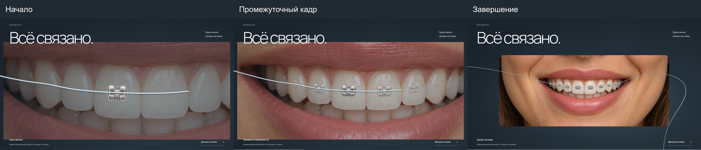
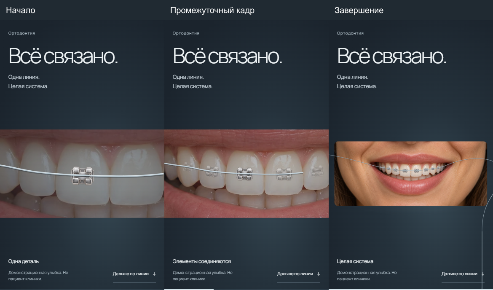
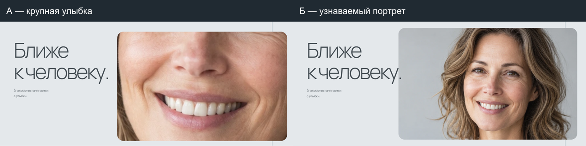
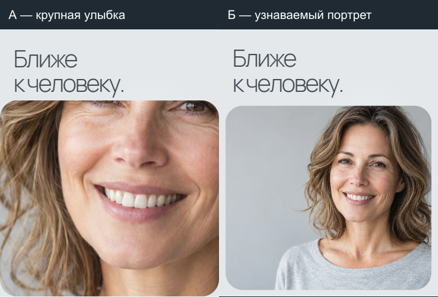

# Проверка прохода по списку доработок

Код: **72c72b17dd3f3e05ad2b57a9e0f3c5ad2e894440**, ветка `feature/site-review-polish`, база 17cda01 (этап функций сохранён отдельно). Main/Pages этим проходом не обновлялись.

Preview: http://localhost:4186/. Сравнение А/Б: http://localhost:4186/orthopedics-reveal-review/. Для другого компьютера нужно запустить собственный preview этой ветки. Полный отчёт по шести пунктам — [SITE-REVIEW.md](../../SITE-REVIEW.md), материалы — [CONTENT-REPLACEMENT.md](../../CONTENT-REPLACEMENT.md).

## Посадка брекетов: начало → промежуточное → конец

Это запрошенные иллюстрации для просмотра, а не весь массив диагностических кадров. WebP сохранены без потерь из PNG-снимков браузера. Все остальные кадры остаются в игнорируемом work.

Desktop, viewport 1440:



Полное разрешение: [начало](assets/braces-desktop-start.webp), [промежуточное](assets/braces-desktop-middle.webp), [конец](assets/braces-desktop-end.webp).

Mobile, эмуляция viewport 390:



Полное разрешение: [начало](assets/braces-mobile-start.webp), [промежуточное](assets/braces-mobile-middle.webp), [конец](assets/braces-mobile-end.webp).

Фото и брекеты не перемещаются относительно друг друга при появлении: убран старый подъезд с дёсен. Один источник опорных точек задаёт фото, брекеты и интерполяцию дуги, камера фото и дуги совпадает во всех проверенных фазах. Центры уточнены по оригиналу, размер боковых элементов уменьшен. Это художественная посадка; клиническое подтверждение остаётся за заказчиком.

Точки слева направо **на изображении**, в пикселях оригинала 1536×1024:

| Элемент | x | y |
| --- | --- | --- |
| 1 | 464 | 396 |
| 2 | 496 | 402 |
| 3 | 546 | 409 |
| 4 | 615 | 422 |
| 5 | 710 | 429 |
| 6 | 825 | 430 |
| 7 | 920 | 421 |
| 8 | 990 | 411 |
| 9 | 1045 | 402 |
| 10 | 1086 | 394 |

## Ортопедия: две альтернативы первого кадра

Desktop:



Mobile:



А — крупная улыбка с отдалением; Б — узнаваемый портрет с мягким раскрытием. Одна фотография и сопоставимая сцена. Основная страница не переключена на А/Б; на телефоне исправлена слишком узкая начальная апертура. При reduced motion и без JS показан целый неподвижный портрет.

## Что прошло

- [results.json](results.json): 320/390/768/1440 × normal/reduced/no-JS для семи основных страниц и сравнения. Нет горизонтального переполнения и ошибок страницы; служебные редакционные инструкции отсутствуют; AI-карточек врачей нет.
- Брекеты: 0/.3/.65/1 и обратный ход, одинаковые камеры фото/дуги, неподвижные относительно зубов anchors. После ограничения paint-области повторены все четыре ширины и три режима.
- Портреты: 0/.5/1/.5/0 для current/А/Б. Холодный кеш и сеть 100000 байт/с с RTT 150 мс, удержание ответа изображения: до decode фото не показывается и motion не проигрывается, высота до/после отличается менее чем на 2 px. Проверены 390/1440 и reload посреди сцены. Refresh посреди ортодонтии также проверен на четырёх ширинах.
- Поиск/карта сайта/чтение: повторён scripts/verify-site-functions.mjs; состояние настроек между страницами/вкладками, девять сочетаний, клавиатура/Escape, no-JS/reduced. Проверка обновлена под требуемое скрытие AI-карточек.
- [map.json](map.json): стандартный iframe OpenStreetMap действительно загрузился, виден Магнитогорск, canvas есть, маркеров нет. Атрибуция сохранена. Параметров marker/маршрута нет. Документация: [встраивание](https://wiki.openstreetmap.org/wiki/Export#Embeddable_HTML), [атрибуция](https://www.openstreetmap.org/copyright).
- Astro check: 104 файла, 0 ошибок/предупреждений/hints. Production build: 27 маршрутов, включая старые стенды, которые не входят в поиск/карту основного сайта. git diff --check без ошибок.

## Производительность без завышенных выводов

Портрет 2210389 байт PNG → 170654 байта WebP, то же разрешение. Исходник сохранён. Убраны лишние SVG-записи и пересчёты геометрии при изменении мобильной панели браузера без реального изменения размеров сцены. Невидимая SVG-линия до y=5000 ограничена y=1400, paint-область — границами уже обрезаемой сцены. Сравнение конечных кадров 390/1440 до/после отсечки: 0 изменённых цветовых каналов.

Одиночные прогоны Chrome headless CPU×4, 120 RAF: p95 14.4→14.2 мс, TaskDuration 0.271→0.371 с. Замеры шумные и не доказывают ускорения на реальном телефоне. Сильное подлагивание здесь не воспроизведено; физическое устройство/Safari нужно проверить отдельно. Вариант А с макро-приближением ограничен детализацией одного исходного кадра.

## Получить и повторить

```sh
git fetch origin feature/site-review-polish qa/site-review-polish
git show origin/qa/site-review-polish:qa/site-review-polish/README.md
```

Код получить в собственной рабочей копии, не накладывать поверх незакоммиченной работы. Для повторения: npm ci, npm run build, локальный static preview dist, `node scripts/verify-review-round.mjs` и `node scripts/verify-site-functions.mjs`. PREVIEW_URL/BROWSER_PATH можно переопределить. Физическое устройство, клиническая точность и юридическое соответствие не проверялись. Внешняя карта требует сети. Реальная запись, анкеты, аналитика и медицинское наполнение отсутствуют по границам задачи.
